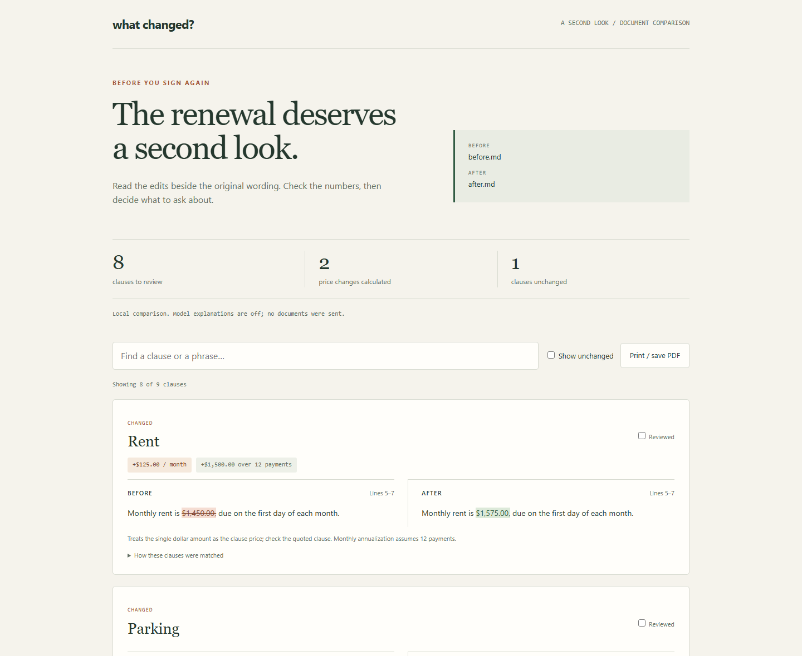

# What changed?

[](https://github.com/charanneelam123-dot/what-changed/actions/workflows/checks.yml)

A renewal arrives. The rent went up, but so did the notice period. A parking charge
appeared halfway down the page. Comparing the two files by eye gets old quickly.

This tool puts each edit next to the original clause. It calculates simple price
changes, keeps the source line numbers, and writes a report you can open in a browser.



## Try it

You need Python 3.11 or newer. The comparison itself uses the standard library.

```bash
git clone https://github.com/charanneelam123-dot/what-changed.git
cd what-changed
python -m what_changed samples/before.md samples/after.md --out reports/renewal
```

Open `reports/renewal/index.html`. Search for a phrase, mark clauses as reviewed,
or print the report. `report.json` contains the same evidence in a reusable format.
The checkboxes reset when you close the page.

The [committed example](examples/renewal/index.html) uses two fictional agreements:

| Clause | What the report finds |
|---|---|
| Rent | $1,450 → $1,575 monthly; a $125 increase, or $1,500 over 12 payments |
| Parking | Included → $65 monthly; flags the wording without guessing a baseline amount |
| Moving notice | 30 → 60 days |
| Repair acknowledgement | 3 → 7 days |
| Guests | 14 → 7 days |
| Pets | Same wording, different position |
| Storage | Removed |
| Package service | New $12 monthly fee |

There is no combined cost estimate. A changed parking benefit and a new mandatory
fee are different questions, and the tool does not know whether you use the parking.

## Where the model fits

The local comparison works without a model. Add `--live` to ask one to explain the
changed clauses and suggest questions to ask about them:

```powershell
$env:OPENAI_API_KEY = "your-key"
$env:OPENAI_MODEL = "your-model-id"
python -m what_changed samples/before.md samples/after.md --out reports/review --live
```

Choose a model that supports Chat Completions and JSON object output. The
[API reference](https://developers.openai.com/api/reference/resources/chat) documents
the request fields. `.env.example` lists the environment variables; the program
does not load `.env` files automatically.

Only changed clause bodies and their headings go to the provider. Each explanation
must include exact quotes from both versions, or an empty quote for a missing side.
The application rejects invented quotes, unknown clause IDs, and duplicate notes.
The report separates accepted explanations from the deterministic diff.

Quote validation catches bad references. It cannot prove that an explanation is
true. A model can still misread a valid quote. This project compares text; it does
not determine whether a term is enforceable or give legal advice.

The request has a 60-second timeout and a 4,000-token output limit. A failed model
call leaves the local report intact and returns exit code 2. Nothing retries a paid
request in the background. If the model omits a clause, that clause keeps its diff
without an explanation.

## Input and privacy

Use UTF-8 `.txt` or Markdown text. Markdown headings and numbered headings make
clause matching more reliable. Without headings, blank lines separate paragraphs.
PDF extraction and OCR are outside this version.

Default runs stay on your machine. The HTML report embeds the compared text, has
no external scripts or fonts, and makes no network requests. Share reports as
carefully as the original documents. Live mode sends changed clauses to OpenAI
and incurs API usage.

The parser limits each document to 250,000 characters and 200 clauses. A live
review accepts at most 50,000 characters of serialized changes. Large rewrites,
duplicate headings, or paragraphs split across versions can confuse the matcher;
every card tells you how it matched the clauses.

## Why the code is arranged this way

`compare.py` does the alignment and arithmetic. Unique headings are matched first,
then identical bodies, then unmatched bodies with at least 65% token overlap.
Approximate matches carry a check-this-match label. A sequence comparison separates
reordering from insertions, so adding a clause does not mark everything below it
as moved. Renamed headings still count as an edit.

The price parser handles one dollar amount and one explicit frequency per clause.
It uses `Decimal`, refuses mixed monthly/annual wording, and skips clauses with
several amounts. This is a narrow extraction rule, not a financial model. The UI
shows its assumptions beside each calculation.

`review.py` owns the optional provider call and quote checks. `render.py` escapes
document content and builds a standalone report. `cli.py` ties them together and
records content hashes so a JSON report can be checked against its inputs.

I kept the model out of the matching and arithmetic. Those steps should be easy
to test without an API account. A broader document matcher would need a labeled
set of real edits before adding semantic similarity or claiming better accuracy.

## Checks

```bash
python -m unittest discover -s tests -v
```

The 37 tests cover moved clauses, inserted sections, duplicate headings, ambiguous
prices, decimal arithmetic, fabricated model quotes, unsafe HTML, and provider
failure. Provider tests use mocked responses. A paid live request has not been run.
GitHub Actions also installs the package and checks the CLI on Python 3.11–3.14.

The small sample documents are examples, not an accuracy benchmark. Known weak
spots and the local validation record are in [notes on the implementation](docs/notes.md).

MIT license.
